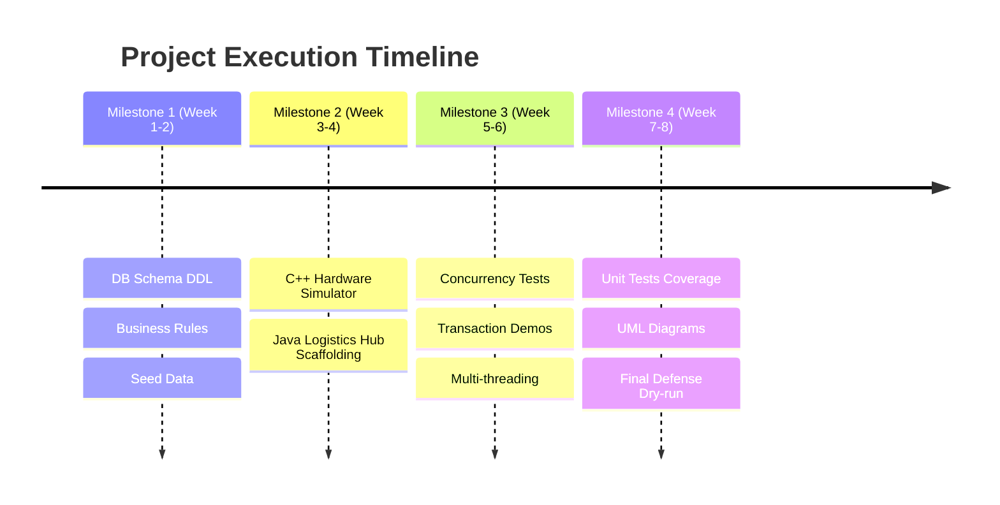

# Unified Architecture Plan: The "Two-in-One" Strategy

## Executive Summary
This document establishes the unified system architecture bridging the requirements of:
1. **Prof. Kutria (OOP)**: Comprehensive C++20 and Java 21 implementation, rich OOP design, design patterns, multi-threading, unit testing, UML documentation.
2. **Prof. Baraban (Databases)**: PostgreSQL transactional engine, 3NF schema, 8 business rules, central ACID transaction with rollback demonstration, 2-session concurrency demonstration.

---

## 1. System Topology

```
                  +----------------------------------------------+
                  |         PostgreSQL Database Engine           |
                  |  - Schema 3NF & Constraints                  |
                  |  - Stored Procedures (Central Transaction)   |
                  |  - Row-Level Locking (Concurrency Control)   |
                  +----------------------------------------------+
                                  ^              ^
                                  |              |
                          (libpqxx)                (JDBC)
                                  |              |
                                  v              v
      +-----------------------------+          +-----------------------------+
      |  C++ Station Controller     |          |  Java Logistics Hub         |
      |  (Edge / Locker Hardware)   |          |  (Central Management Hub)   |
      +-----------------------------+          +-----------------------------+
      | - Multi-threaded Hardware   |          | - Order Lifecycle Engine    |
      |   Lockers Simulation        |          | - Courier Routing & Shifts  |
      | - Sensor Telemetry          |          | - Notification Service      |
      | - Smart Pointers & STL      |          | - Analytical Reporting      |
      | - Custom Exception Hierarch.|          | - Generics & Streams API    |
      +-----------------------------+          +-----------------------------+
```

---

## 2. Subsystem Division of Responsibilities

### Subsystem A: Central PostgreSQL Database (Shared Core)
- **Role**: Single source of truth for both C++ and Java modules.
- **Responsibilities**:
  - DDL schema definition (`stations`, `compartments`, `parcels`, `couriers`, `customers`, `audit_event_log`).
  - Stored procedure `sp_deposit_parcel()` demonstrating atomic commit & rollback.
  - Scripted concurrency scenario showing safe row locking (`SELECT ... FOR UPDATE`).
  - Seed dataset with realistic locations, couriers, and dimensions.

### Subsystem B: C++ Station Controller (`cpp-station-controller`)
- **Role**: Edge terminal installed on the physical locker station.
- **Key Features**:
  - `LockerStationApplication`: Main application class managing runtime loop and cleanup.
  - Polymorphic compartment hierarchy (`StandardCompartment`, `RefrigeratedCompartment`, `OversizedCompartment`).
  - Hardware simulation: concurrent client/courier interactions modeled using `std::thread` and `std::mutex`.
  - Generic bounded queue (`template <typename T> class SafeQueue<T>`) for sensor event telemetry.
  - Receipt and audit log generation using `<fstream>` with overloaded `operator<<`.
  - Unit tests powered by Google Test (`gtest`).

### Subsystem C: Java Logistics Hub (`java-logistics-hub`)
- **Role**: Backend management and dispatching service.
- **Key Features**:
  - `CentralLogisticsApplication`: Main console application for logistics operators.
  - Generic repository pattern (`interface Repository<T, ID>`) managing database access.
  - Multi-threaded asynchronous dispatching of customer notifications (`ExecutorService`, `CompletableFuture`).
  - Stream-based analytics (station occupancy heatmaps, courier delivery velocity).
  - Strongly typed domain models using Java records and custom exceptions.
  - Comprehensive unit test suite with JUnit 5.

---

## 3. Team Member Allocation

| Developer | Primary Responsibility | Target Deliverables |
| :--- | :--- | :--- |
| **Nikita Kalashnikov** | Tech lead, database architecture, code quality and integration | Database contract, schema (#3), `sp_deposit_parcel` and rollback demo (#5), CI and contract tests, reviews, the first vertical slice. |
| **Serhii Bulovinov** | C++ station controller and hardware simulator | Thread-safe locker station, polymorphic compartment hierarchy, database adapter, gtest test suite, sensor event loop. |
| **Artem Tiutiun** | Java logistics hub and dispatching service | Generic repository, database adapter, async notification worker pool, reporting and analytics streams, JUnit 5 test suite. |
| **Nazar Kuryliv** | Database rules, analytics and documentation | ERD and normalization (#2), business rule triggers (#4), concurrency demo (#6), views and indexes (#7). Starts after the schema (#3) is merged. |

---

## 4. Development Milestones & Timeline



1. **Phase 1: Database & Domain Foundation**
   - Finalize ERD, normalized DDL, business rules, and seed dataset.
   - Run ACID rollback demo and two-session concurrency verification.
2. **Phase 2: Core Domain Implementation (C++ and Java)**
   - Implement base domain classes following the 350-line file limit.
   - Wire up polymorphic compartment logic in C++ and logistics routing in Java.
3. **Phase 3: Concurrency, Multithreading & Testing**
   - Implement `std::thread` simulation in C++ and `ExecutorService` in Java.
   - Achieve comprehensive coverage with Google Test and JUnit 5.
4. **Phase 4: UML, Documentation & Final Presentation Defense**
   - Generate official UML Class and Sequence diagrams.
   - Prepare terminal walkthrough demonstrations for both professors.
